# Termail

Windows Terminal içinde çalışan, sade ve hızlı bir e-posta programı. Tek bir dosya (`termail.exe`), kurulum yok.

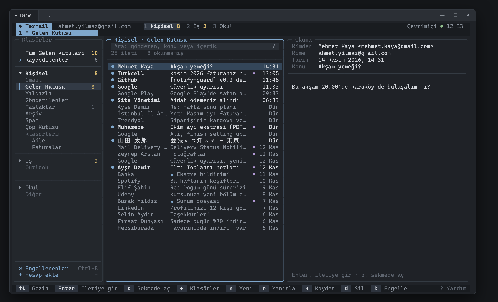

## Kurulum

Termail tek bir dosyadır: `termail.exe`.

**Kolay yol (önerilen):**

1. `termail.exe` dosyasını indir (ör. İndirilenler klasörüne).
2. Dosyanın bulunduğu klasörde Windows Terminal'i ya da PowerShell'i aç. Gezginde klasöre sağ tıklayıp "Terminalde aç" diyebilirsin.
3. Şunu yaz ve Enter'a bas:
   ```
   .\termail.exe kur
   ```
4. "Kuruldu. Yeni bir terminal açıp termail yaz." yazısını görünce **yeni** bir terminal penceresi aç.
5. Artık her yerde sadece `termail` yazman yeterli. Program aynı pencerede açılır.

Kurulum programı senin kullanıcı klasörüne (`%LOCALAPPDATA%\Programs\Termail`) kopyalar ve o klasörü arama yoluna ekler. Yönetici izni gerekmez. Geri almak için: `termail kaldır`. Ayarların ve kayıtlı girişlerin silinmez.

**Elle kurmak istersen:**

1. `%LOCALAPPDATA%\Programs\Termail` adında bir klasör oluştur ve `termail.exe`yi içine koy.
2. Başlat menüsünde "ortam değişkenleri" ara ve "Hesabınız için ortam değişkenlerini düzenleyin"i aç.
3. Üstteki listede **Path** satırını seç, **Düzenle** → **Yeni** de ve klasörün yolunu yapıştır. Tamam ile kapat.
4. Yeni bir terminal aç ve `termail` yaz.

İstersen kurmadan da kullanabilirsin: terminalde dosyanın bulunduğu klasöre gidip `.\termail.exe` yaz. Dosyaya çift tıklarsan da kendi penceresinde açılır.

## Başlarken

1. `termail` yaz (ya da `termail.exe`yi çalıştır).
2. E-posta adresini yaz. Termail hangi sağlayıcıyı kullandığını kendisi anlar; sunucu ayarı girmen gerekmez.
3. Şifreni yaz ve **Enter**'a bas. Şifren Windows'un kendi güvenli kasasında saklanır, bir daha sorulmaz.

Önce denemek istersen: `termail --demo` örnek postalarla açılır, hiçbir şey göndermez.

### Gmail

Gmail normal şifreni kabul etmez; bunun yerine bir **uygulama şifresi** ister.

- Giriş ekranında **Ctrl + O** tuşlarına bas (**O harfi**, sıfır değil). "Uygulama şifreleri" sayfası tarayıcında açılır; açılmazsa sayfanın adresi ekranda gösterilir ve panoya kopyalanır.
- Google hesabında iki adımlı doğrulama açık olmalıdır.
- Sayfada bir ad yaz (ör. "Termail"), oluşturulan 16 harfli şifreyi kopyala ve Termail'deki şifre alanına yapıştır.

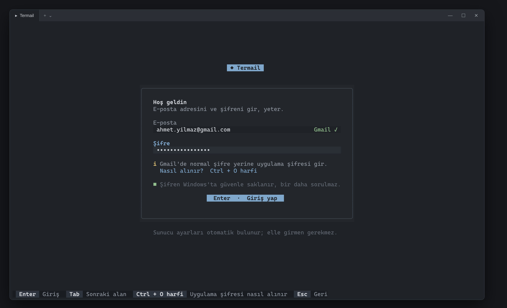
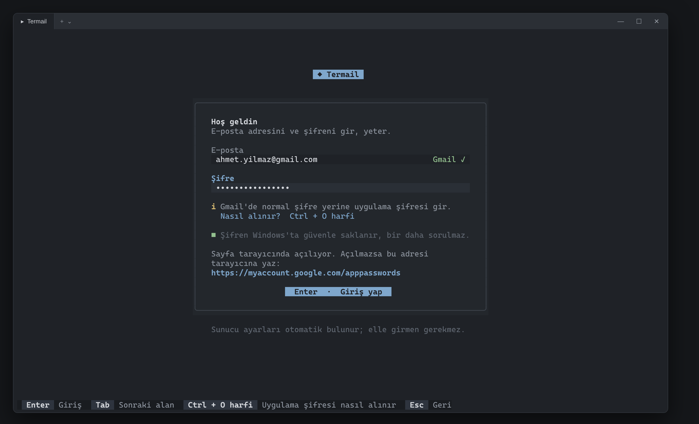

### Outlook / Hotmail / Live

Outlook, Hotmail, Live, MSN ve iş/okul Microsoft 365 adresleri için şifre gerekmez.

1. E-posta adresini yaz, **Enter**'a bas ("Tarayıcıda Microsoft ile giriş yap").
2. Tarayıcıda Microsoft sayfası açılır; hesabını seçip izin ver.
3. Tarayıcıda "Giriş tamam, Termail'e dönebilirsin" yazınca Termail'e dön; hesap eklenmiştir.

Tarayıcı açılmazsa **Ctrl+L** ile bağlantıyı kopyalayıp tarayıcına yapıştır. Tarayıcıda bir hata çıkarsa ya da başka bir cihazdan girmek istersen **k**'ya bas: ekranda büyük bir kod ve bir adres çıkar; o adrese git, kodu yaz (**c** kodu kopyalar). Giriş Windows'un Kimlik Bilgileri Yöneticisi'nde saklanır, oturum kendiliğinden yenilenir. Microsoft oturumu bir gün sona ererse hesap "giriş gerekli" olarak görünür; yeniden giriş yapman yeter. "Microsoft uygulama ayarı kişisel hesaplara kapalı" uyarısı çıkarsa, uygulama kaydında desteklenen hesap türlerine kişisel Microsoft hesapları eklenmelidir.

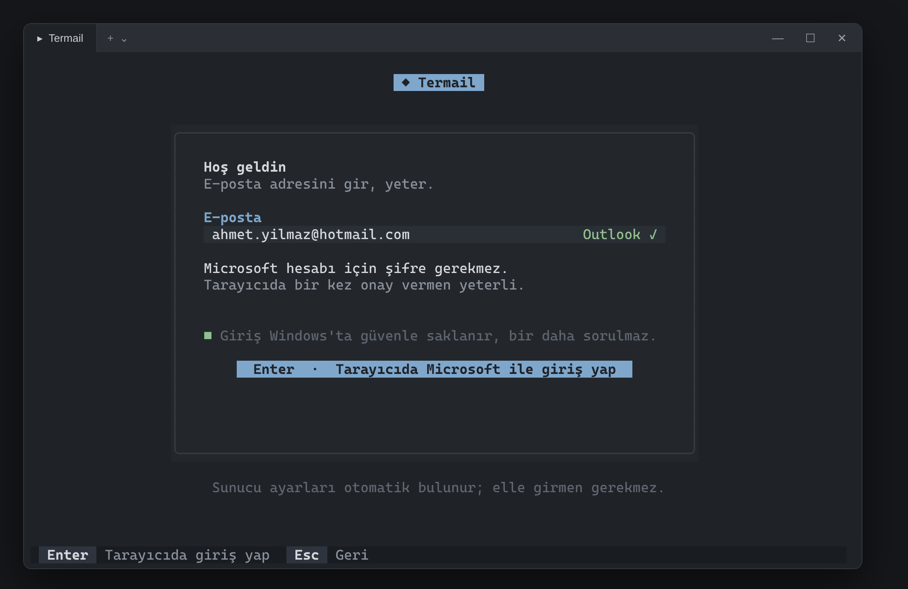

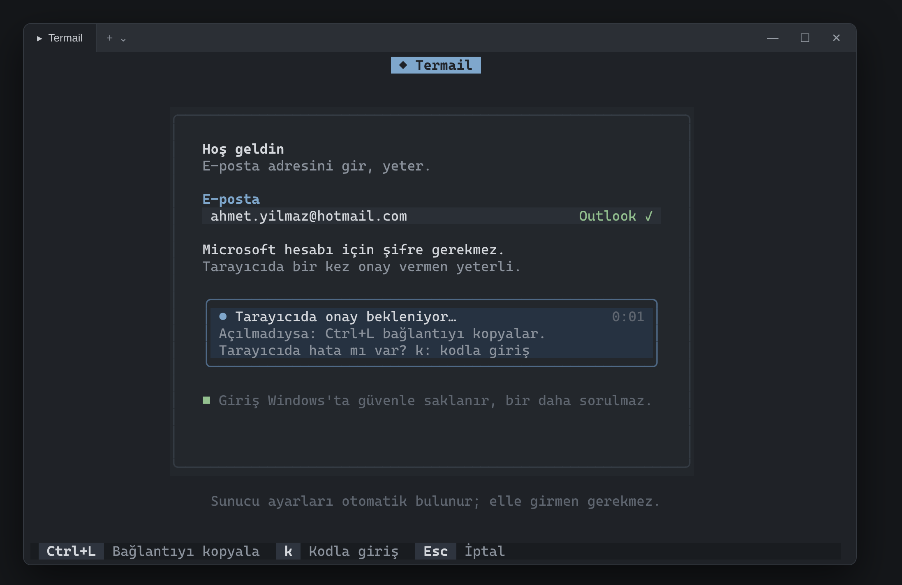

### Diğer sağlayıcılar

Yahoo, Yandex, iCloud, GMX, Zoho, Turkcell/Superonline ve kendi alan adındaki çoğu adres otomatik bulunur. Bazı sağlayıcılar (Yahoo, iCloud gibi) Gmail'deki gibi uygulama şifresi ister.

## Kullanım

Ekranın altındaki satır o an kullanabileceğin tuşları gösterir; **?** tuşu tam listeyi açar.

Hangi bölümde olduğun her zaman bellidir: **etkin bölmenin çerçevesi mavi** ve başlığı kalın, diğerleri gri. Üstteki etkin sekme de mavi zeminle gösterilir.

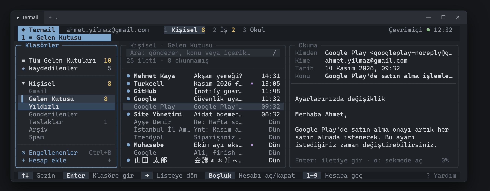
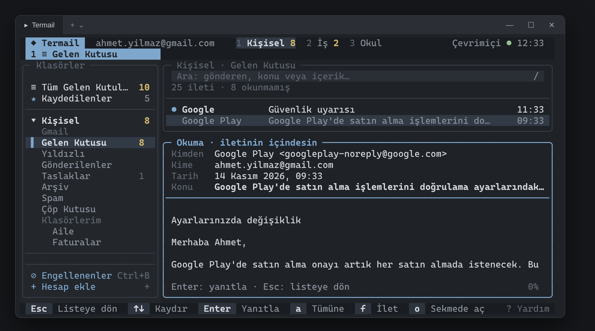

> **Ctrl** ile birlikte basılan tuşlar **harftir**: Ctrl+S → S harfi, Ctrl+O → O harfi, Ctrl+B → B harfi. Rakam olanlar ayrıca belirtilmiştir (Alt+1-9, 0-9).

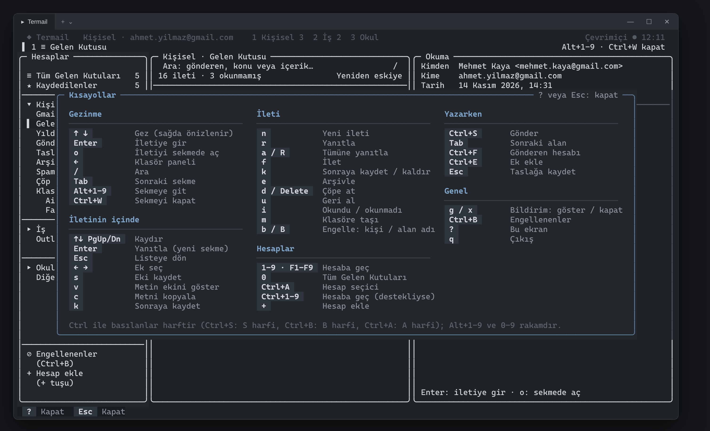

### Gezinme ve okuma

| Tuş | Ne yapar |
|---|---|
| ↑ ↓ | İletiler arasında gez; seçili ileti sağda hemen görünür |
| Enter | İletinin içine gir (kaydırma; e: Ekler ve Bağlantılar sekmesi) |
| → | Klasör panelinden listeye, listede iletiye gir (Enter ile aynı); grup başlığında grubu açar |
| Enter (iletinin içinde) | Yanıtla (yeni sekmede) |
| ] / [ | İletinin içindeyken sonraki / önceki ileti (listeye dönmeden; yeni ileti okundu olur). `o` ile tarayıcıda açılan iletide geçmez. |
| Esc | Listeye dön |
| o | Seçili iletiyi varsayılan tarayıcıda aç (gövde henüz yoksa «Mail yükleniyor, tarayıcıda açılacak...» der ve gelince açar; açılamazsa hata gösterir) |
| t | Seçili iletiyi Termail sekmesinde aç (çift tık ile aynı) |
| ← | Bir adım geri: iletiden listeye, listeden klasör paneline (klasörlerdeyken ↑ ↓ ile gezin, Enter veya → ile listeye dön) |
| / veya Ctrl+F | Ara (aşağıya bakın) |
| Shift+G | Gönderene göre grupla / düz liste (liste, klasör paneli ve okuma panelinden). Grup başlığında d, o gönderenin bu görünümdeki tüm maillerini (onaydan sonra) siler |
| Tab / Alt+1-9 / Ctrl+W | Sonraki sekme / sekmeye git / sekmeyi kapat |
| w | İletideki bağlantıların listesi (aç / kopyala) |
| c | İletinin metninin tamamını panoya kopyala ("Metin kopyalandı") |
| C (Shift+c) | Gönderenin e-posta adresini kopyala ("Adres kopyalandı") |

**Gelen Kutusu** yalnızca okunmamış iletileri gösterir. Okunanlar, her hesapta Gelen Kutusu'nun hemen altındaki **Okunanlar** klasöründedir (Tüm Gelen Kutuları'nın altında da tüm hesapların Okunanlar'ı vardır). Okunanlar sunucuda ayrı bir klasör değildir; gelen kutusundaki okunmuş iletilerdir, hiçbir ileti taşınmaz. En son açılan / okunan ileti listenin en üstündedir. Okunanlar'da sayı gösterilmez.

Açılışta son oturumun ileti listesi hemen görünür; geri kalanı en yeniden eskiye büyük sayfalar halinde yüklenir. Liste henüz tamam değilse üstte **Yükleniyor 420/3800** gibi bir yazı çıkar.

Bir ileti yalnızca Enter, →, çift tık, **t** ya da **o** ile açıldığında okundu sayılır ve Okunanlar'a geçer. Üzerinde durmak, yanda önizlemek okundu yapmaz. Enter ile okurken ileti listede yerinde kalır; listeye dönünce Gelen Kutusu'ndan çıkar ve sıradaki okunmamış ileti seçilir. **i** okundu/okunmadı arasında geçer; ileti siz klasörden çıkana ya da yenileyene kadar yerinde kalır, liste zıplamaz. Arama ve gönderene göre gruplama iki görünümde de çalışır.

Alttaki tuş çubuğu yalnızca o ekranın en sık kullanılan kısayollarını gösterir (listede →/Enter, t, n, r, d, k, o, /; iletinin içinde r, a, f, e, ]/[, Esc). Tüm kısayollar **?** yardımında durur; tuşlar çubukta görünmese de çalışır (ör. iletinin içinde Enter hâlâ yanıtlar, o hâlâ tarayıcıda açar). Liste eylemleri (**o**, **t**, **d**, **i**, **k**, **r**, **a**, **f**, Shift+G ve benzeri) klasör panelinden veya okuma panelinden de, seçili / açık ileti üzerinde çalışır (okuma panelinde **e** ekler sekmesidir, arşiv değil).

Klasör panelinde gezerken her klasörün iletileri ortadaki listede hemen görünür. Daha önce açılmış klasörler anında gelir; ilk kez açılan bir klasörde eski liste yerinde kalır ve üstte kısaca "yükleniyor…" yazar. Klasörler arasında gezmek iletileri okundu yapmaz, yeni posta bildirimlerini de etkilemez.

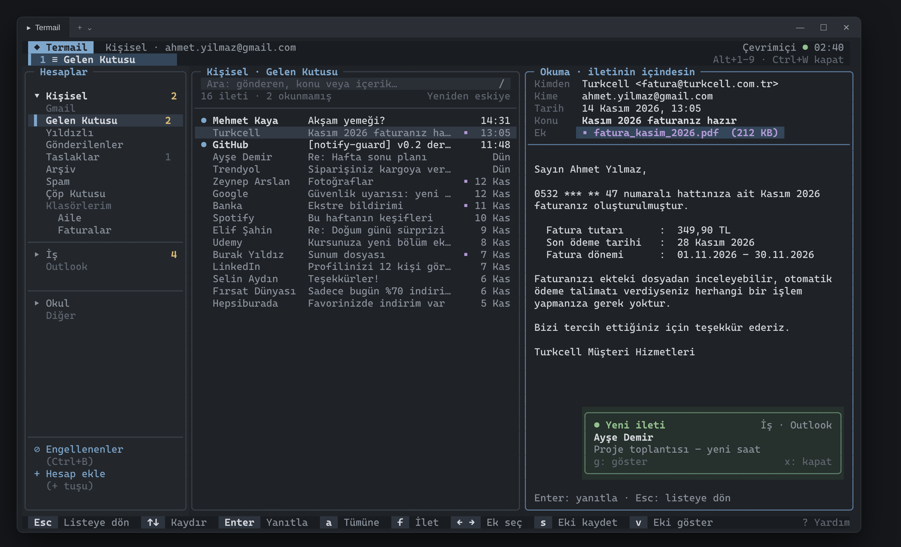

Gelen iletiler sade metin olarak gösterilir: HTML iletiler okunur metne çevrilir, Türkçe karakterler (eski kodlamalar dahil) doğru görünür. Teslim edilemedi bildirimlerinde açıklama gösterilir, teknik ayrıntılar ek olarak durur. Konu ve gönderen adlarındaki emojiler ekran düzeni bozulmasın diye gösterilmez. Reklam iletilerindeki görünmez dolgu karakterleri (`&#847; &zwnj; &#8199; &#65279;` gibi) ve gizli önizleme metinleri gösterilmez.

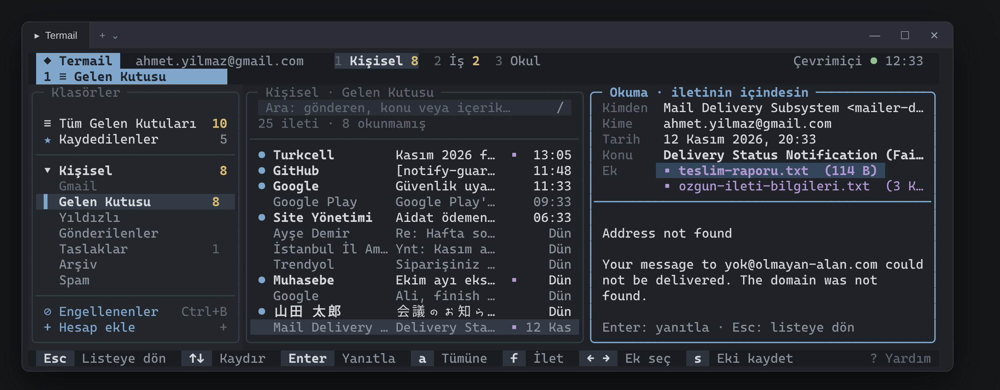

#### İletideki bağlantılar

İletideki her bağlantının yanında küçük, soluk bir numara durur: `kampanyalar sayfasına [2]`. Aynı adrese giden bağlantılar aynı numarayı alır. Çok uzun adresler kısaltılarak gösterilir (`kargotakip.example.com.tr/sorgula?takipNo=73400… [4]`). Tehlikeli bağlantılar (tarayıcıda kod çalıştıranlar, iletinin içine gömülü resimler) ve gizli takip resimleri numaralanmaz, açılamaz.

**w** tuşu "Bağlantılar" listesini açar (iletinin içindeyken de, listede bir ileti seçiliyken de). **l** harfi ekler arasında gezmek için kullanıldığından bağlantılar için **w** ("web") seçildi.

| Tuş (listede) | Ne yapar |
|---|---|
| ↑ ↓ ve Enter | Seçili bağlantıyı tarayıcıda aç |
| 1-9 | O numaralı bağlantıyı hemen aç (9'dan fazla bağlantı varsa numarayı yazıp Enter'a bas) |
| y | Adresi panoya kopyala |
| Esc | Listeyi kapat |

Her satırda bağlantının yazısı ve **gerçekte gittiği site** yazar: `[2] kampanyalar sayfasına — garantibbva.com.tr`. Bağlantının yazısı bir site adresine benziyor ama başka bir siteye gidiyorsa satır sarı olur ve **"Dikkat: farklı adrese gidiyor"** yazar; bu, sahte (dolandırıcılık) iletilerin sık kullandığı bir hiledir. Altta seçili bağlantının tam adresi görünür. Termail yalnızca `http`, `https` ve `mailto` adreslerini açar; adres tarayıcıya tek parça olarak verilir, komut satırından geçirilmez.

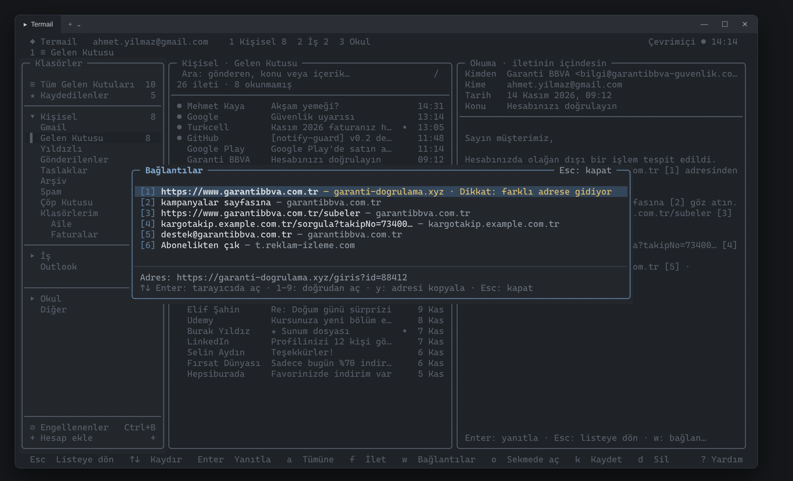

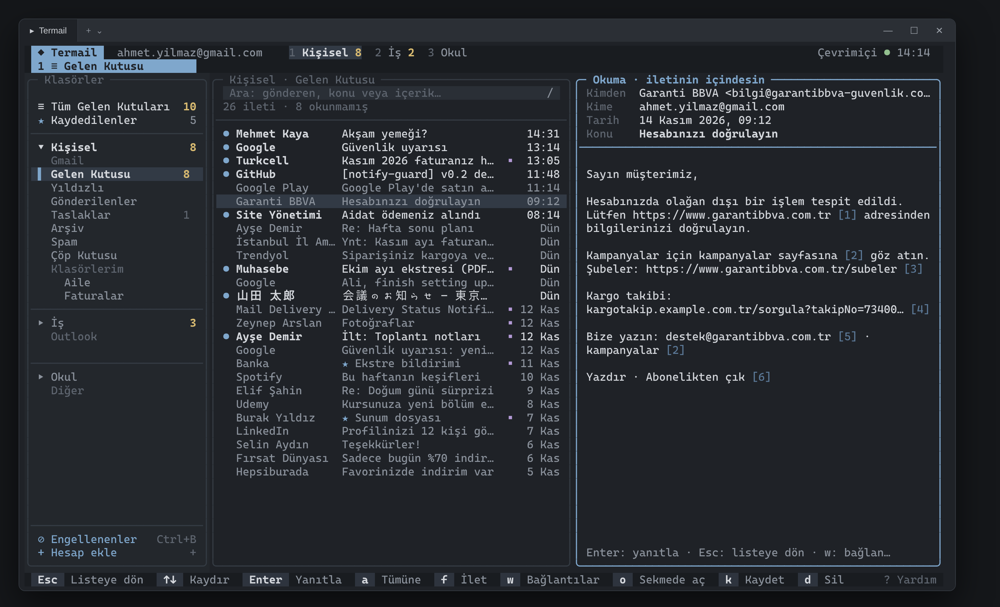

### Fare

Fare de kullanılabilir (klavye kısayolları aynen çalışır):

- Klasöre tıkla: klasörü aç. İletiye tıkla: seç ve yanda göster (tek tık okundu yapmaz). **Çift tık**: iletiyi kendi sekmesinde aç. Tıklanabilir yerlerin (sekmeler, klasör ve ileti satırları, başlık, ek/bağlantı satırları, düğmeler) üzerinde fare durunca satır vurgulanır.
- **Tekerlek**: imlecin üstünde durduğu yeri kaydırır — listeyi ya da ileti metnini (hangisi seçili olursa olsun). Bir tuşa basınca seçili ileti yeniden görünür.
- Sekmeye tıkla: o sekmeye geç. Sekmedeki **×**: sekmeyi kapat (yazılmakta olan ileti Ctrl+W'deki gibi taslağa kaydedilir).
- İletideki bağlantıya ya da numarasına tıkla: tarayıcıda aç (aynı güvenlik kontrolüyle).
- **İleti metninde sürükle: metni seç.** Bırakınca seçilen yazı panoya kopyalanır ("Kopyalandı"). **Çift tık** bir kelimeyi, **üç tık** bütün paragrafı seçer. Sürüklerken metnin üstüne ya da altına çıkarsan metin kendiliğinden kayar. Esc ya da bir tık seçimi kaldırır.
- **Sağ tık:** iletide seçili metni kopyalar; yazarken bir alanda panodaki yazıyı yapıştırır.
- Yazarken bir alana tıkla: o alana geç, imleç tıkladığın yere gider. Alanın içinde sürükleyerek seçebilirsin; çift tık kelimeyi, üç tık satırı seçer.
- Bildirimlerdeki **×**, bağlantı listesi ve hesap seçicideki satırlar tıklanabilir.
- Terminalin kendi seçimini kullanmak istersen (ör. ekranın herhangi bir yerinden) **Shift basılı tutarak sürükle** (Windows Terminal). Klasik konsol penceresinde bunun için fareyi kapatabilirsin.

Fareyi kapatmak için `%APPDATA%\Termail\config.json` dosyasına `"fare": "kapalı"` satırını ekle, örneğin:

```json
{
  "accounts": [ … ],
  "fare": "kapalı"
}
```

### İleti işlemleri

| Tuş | Ne yapar |
|---|---|
| n | Yeni ileti |
| r / a / f | Yanıtla / Tümüne yanıtla / İlet |
| k | Sonraya kaydet (tekrar basınca kaldırır) |
| e | Arşivle |
| d veya Delete | Çöpe at (Çöp Kutusu'nda: o iletiyi kalıcı sil) |
| Shift+D | Çöp Kutusu'nu veya Spam'i tamamen boşalt; Gelen Kutusu / Okunanlar'da: hepsini Çöp Kutusu'na taşı |
| u | Geri al |
| i | Okundu / okunmadı |
| m | Klasöre taşı |
| b / B | Gönderen kişiyi / tüm alan adını engelle |

Silme, engelleme, kaydetme ve okundu işaretleri ekranda hemen uygulanır; sunucuya arka planda iletilir. Art arda hızlı silmeler tek seferde gönderilir. Sunucuya ulaşılamazsa ileti eski yerine döner ve kısa bir uyarı çıkar. **u** ile geri almak, işlem sunucuya gitmeden önce de sonra da çalışır.

#### Çöp Kutusu'nu ve Spam'i boşaltmak

Çöp Kutusu'nda ya da Spam'de **Shift+D**'ye bas. Termail kaç ileti olduğunu sorar: "Çöp Kutusu'ndaki 23 iletinin hepsi kalıcı silinsin mi? e/h". Sadece **e** onaylar; **h**, **Esc** ya da başka bir tuş vazgeçer (Enter da vazgeçer). Silme sırasında ilerleme gösterilir. Bu işlem **geri alınamaz**. Diğer klasörlerde Shift+D bir şey silmez.

Gelen Kutusu'nda ya da Okunanlar'da **Shift+D** görünümdeki (listede yüklü) tüm iletileri **Çöp Kutusu'na taşır**, kalıcı silmez. Kırmızı bir pencere sorar: "Gelen Kutusu'ndaki 42 iletinin TAMAMI silinecek. Emin misin? (e/h)". Yalnızca **e** onaylar; Enter dahil başka her tuş vazgeçer. Taşıma toplu UID MOVE ile ve ilerleme göstererek yapılır; sunucu reddederse iletiler yerine döner. Bittikten sonra **u** hepsini geri getirir. Tüm Gelen Kutuları'nda pencere hesap başına sayıları listeler.

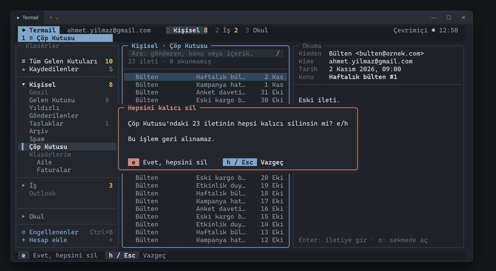

### Kopyalama ve yapıştırma

Her metin alanında (yazarken Kime / Bilgi / Konu / metin, giriş ekranı, arama) aynı kısayollar çalışır:

| Tuş | Ne yapar |
|---|---|
| Shift+← → ↑ ↓ | Seçimi genişlet (Shift+Home / Shift+End: satır başına / sonuna kadar; Ctrl+Shift+← →: kelime kelime) |
| Ctrl+A (A harfi) | Alandaki her şeyi seç |
| Ctrl+C | Seçileni kopyala. Alanın içindeyken **program kapanmaz**; seçili bir şey yoksa hiçbir şey olmaz |
| Ctrl+X | Seçileni kes |
| Ctrl+V | Panodaki yazıyı yapıştır |
| Ctrl+Z / Ctrl+Y | Geri al / yinele (yazarken) |
| Yazmak, Backspace, Delete | Seçili yazının yerine geçer / onu siler |

- Windows Terminal Ctrl+V'yi kendisi yakalayıp yazıyı gönderir; Termail aynı yazının iki kez gelmesini önler, yazı bir kez yapıştırılır.
- Birden çok satırlık yazı ileti metnine satırlarıyla gelir (satır sonları düzeltilir, görünmez kontrol karakterleri atılır, sekmeler boşluğa çevrilir). Tek satırlık alanlarda satırlar boşlukla birleştirilir; **Kime** ve **Bilgi**'de her satır ve `;` bir virgüle dönüşür, yani bir adres listesini olduğu gibi yapıştırabilirsin. Akıl almaz büyüklükte bir yazı (1 milyon karakterden uzun) kısaltılır ve bunu söyleyen bir not çıkar.
- Şifre alanındaki yazı kopyalanamaz ve kesilemez (yapıştırılabilir).
- İleti listesinde ya da açık bir iletide **Ctrl+C**: fareyle seçilmiş metin varsa onu kopyalar; yoksa eskisi gibi programı kapatır.
- **c** iletinin metninin tamamını, **C** gönderenin adresini kopyalar.

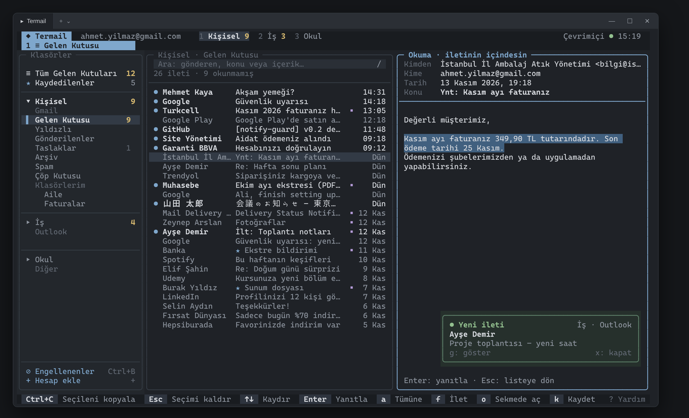

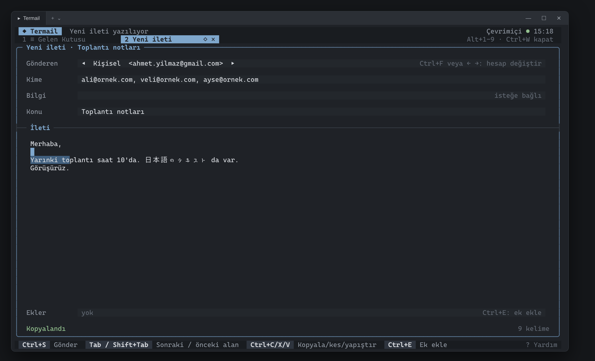

### Yazarken

| Tuş | Ne yapar |
|---|---|
| Ctrl+S (S harfi) | Gönder |
| Tab / Shift+Tab | Sonraki / önceki alan (Kime → Bilgi → Konu → Metin → Ekler → Kime …) |
| ↑ ↓ | Tek satırlık alanlarda önceki / sonraki alan; metinde ilk satırda ↑ Konu'ya, son satırda ↓ Ekler'e geçer |
| Ctrl+↑ / Ctrl+↓ | Önceki / sonraki alan (Shift+Tab çalışmayan terminaller için) |
| Ctrl+E (E harfi) | Ek ekle |
| Ctrl+F (F harfi) | Gönderen hesabı değiştir |
| Ctrl+C / Ctrl+X / Ctrl+V | Kopyala / kes / yapıştır (bkz. Kopyalama ve yapıştırma) |
| Esc | Taslağa kaydet ve kapat (bir şey seçiliyse önce seçimi kaldırır) |

Ctrl+S'ye basınca yazma sekmesi hemen kapanır ve "Gönderiliyor…" bildirimi çıkar; gönderim arka planda yapılır, sonra "Gönderildi" yazar. Gönderilemezse ileti yazdığın her şeyle birlikte yeniden açılır, hiçbir şey kaybolmaz. Gönderim sürerken q önce gönderimin bitmesini bekler (en çok 15 saniye). Gmail ve Outlook gönderilen iletinin kopyasını kendileri Gönderilenler'e koyar; diğer sunucularda kopyayı Termail kaydeder.

**Program dosyaları:** `.exe`, `.bat`, `.msi`, `.js`, `.scr` gibi dosyaları (zip içinde olsalar bile) Gmail, Outlook ve çoğu servis güvenlik nedeniyle geri çevirir; ileti alıcıya ulaşmaz. Termail böyle bir ek eklenince uyarır ve göndermeden önce sorar. Programı paylaşmak için bir bulut klasörü bağlantısı gönder.

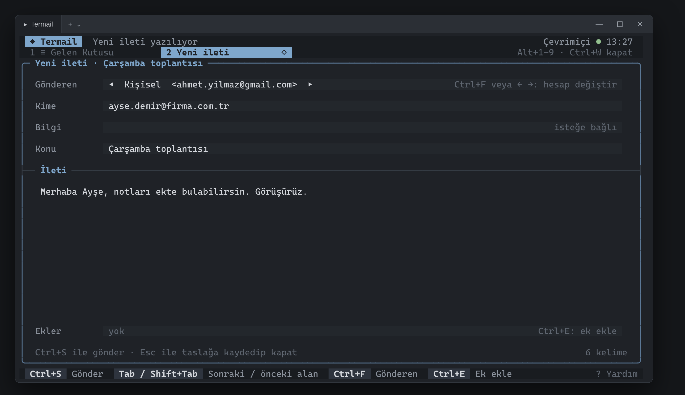

## Arama

**/** ya da **Ctrl+F** tuşuna bas (veya listenin üstündeki arama satırına tıkla). Boş arama satırında son aramaların ve hazır filtreler görünür; birine tıklayıp ya da ↑ ↓ ve Enter ile seçebilirsin.

- Sıralama: önce göndereninde aradığın sözcük geçenler, sonra konusunda geçenler, en son yalnızca metninde geçenler; her grupta en yeni üstte.
- Yazdıkça sonuçlar hemen gelir: önce bilgisayarda zaten olan iletiler, ardından sunucudaki eski iletiler ("sunucuda aranıyor…").
- Gönderen, konu ve ileti metninde arar. Büyük/küçük harf ve Türkçe harfler fark etmez: "ILETI", "ileti" ve "İleti" aynıdır.
- Filtreler (aramaya yazabilirsin): `kimden:ayşe`, `ekli`, `okunmamış`, `kaydedilen`, `bugün`, `dün`, `bu hafta`, `bu ay`. Örnek: `kimden:ayşe ekli bu hafta`.
- **Tab**: nerede arandığını değiştirir: Bu klasör → Tüm klasörler → Tüm hesaplar.
- Bulunan sözcükler listede ve okuma panelinde vurgulanır.
- ↑ ↓ ile gez, Enter ile aç. **Esc** önce yazdığını siler, ikinci Esc aramayı kapatır.
- Son 10 arama hatırlanır (yalnızca aradığın sözcükler; ileti içeriği saklanmaz).

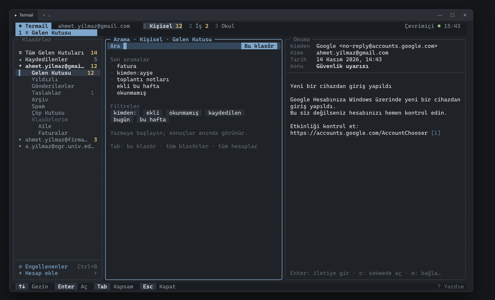
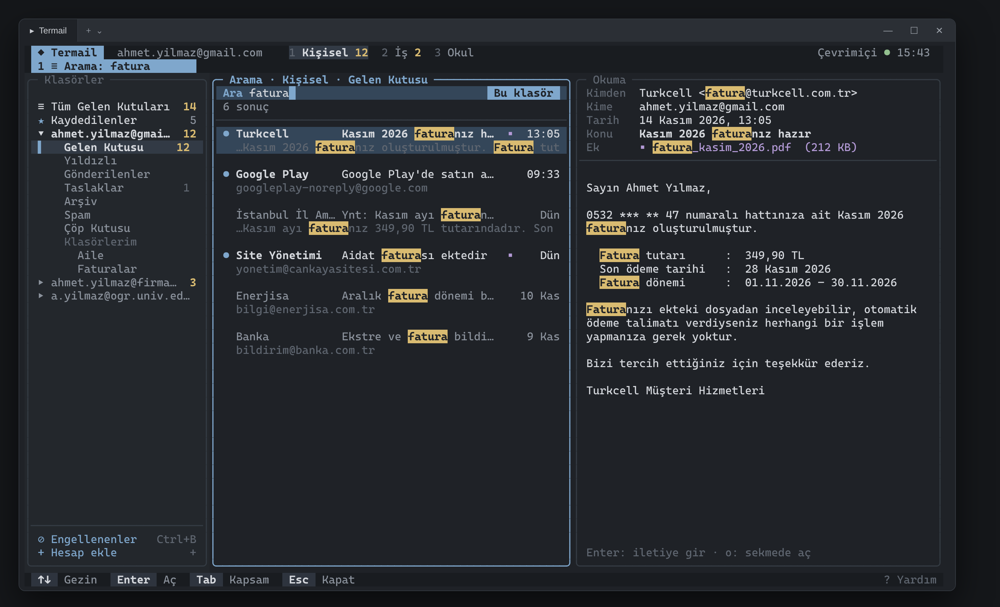
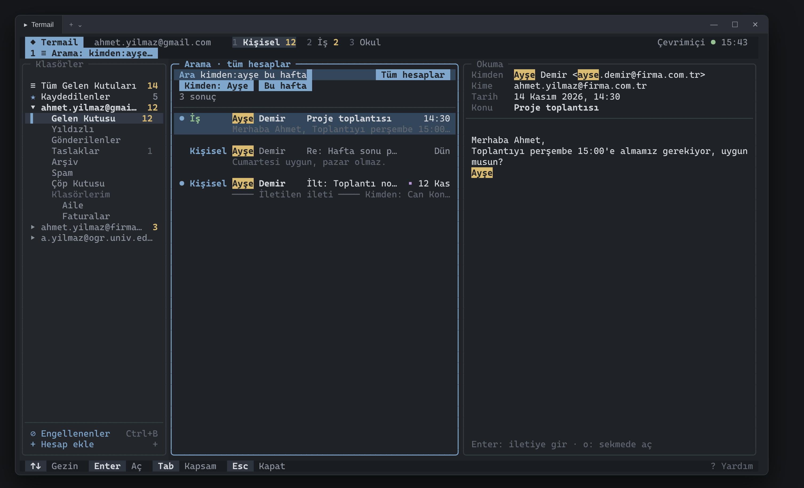

## Gönderene göre gruplama

**Shift+G** aynı yerden gelen iletileri tek satırda toplar (örneğin accounts.google.com ve google.com → "Google (5)"). Tek iletisi olan gönderenler normal satır olarak kalır. "● 3 yeni" okunmamış yeni iletileri gösterir ve grubu açınca kaybolur.

- Enter, Boşluk, → ya da tıklama grubu açar; ← ya da tıklama kapatır.
- Grup satırındayken **d** (sil) gibi tuşlar hiçbir şey silmez; önce grubu açman gerekir.
- Seçimin hatırlanır. Arama sonuçları her zaman düz listedir.

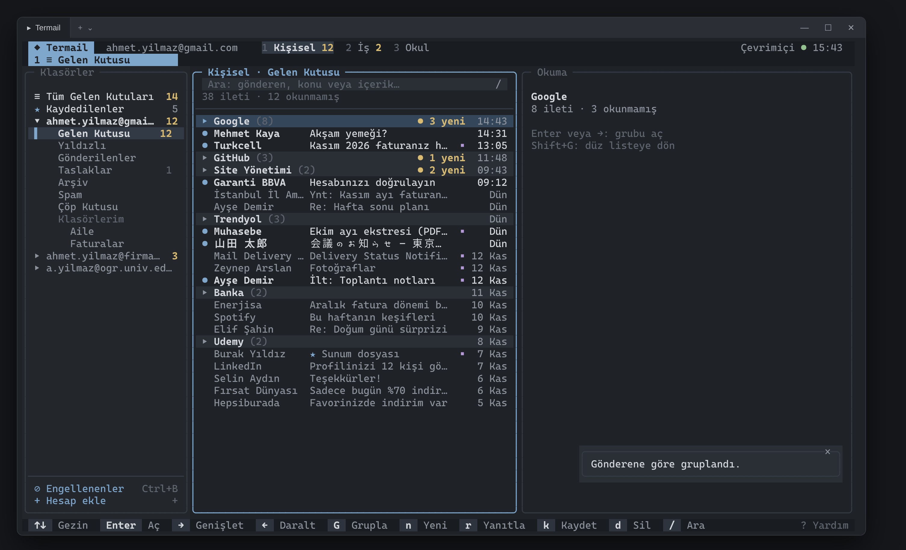
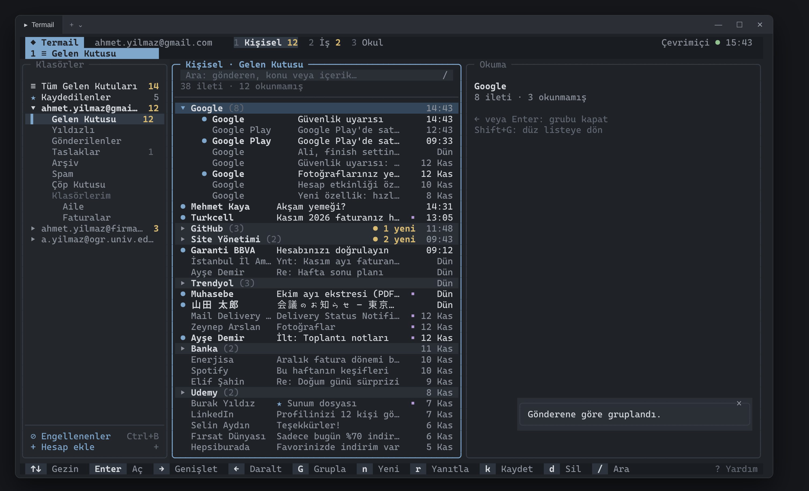

## Birden fazla hesap

- **+** ile yeni hesap ekle.
- **F2–F12**: o hesaba geç (F2 = 1. hesap, F3 = 2. hesap … F12 = 11. hesap). **F1**: Tüm Gelen Kutuları (bütün hesapların gelen postası tek listede). Rakam tuşları (1–9, 0) hesap değiştirmez.
- **Ctrl+A** (A harfi): hesap seçici. Yazı yazarken çalışmaz, yazdığını bozmaz.
- Destekleyen terminallerde **Ctrl+1–9** de çalışır.
- Bir iletiyi yanıtladığında, ileti hangi hesaba geldiyse yanıt o hesaptan gider.
- Klasör panelinde en üstte **Tüm Gelen Kutuları**, altında her hesap kendi okunmamış sayısıyla durur. Hesap satırında Enter, → ya da tıklama klasörlerini açar; Enter ya da ← kapatır. Hangi hesapların açık olduğu hatırlanır. Üst çubukta hesaplar **F2**, **F3** … olarak görünür; etkin hesabın sekmesi dolu bir vurgu rengindedir. Hesap tuşları (F1–F12, Ctrl+A) o hesabı açıp seçer.

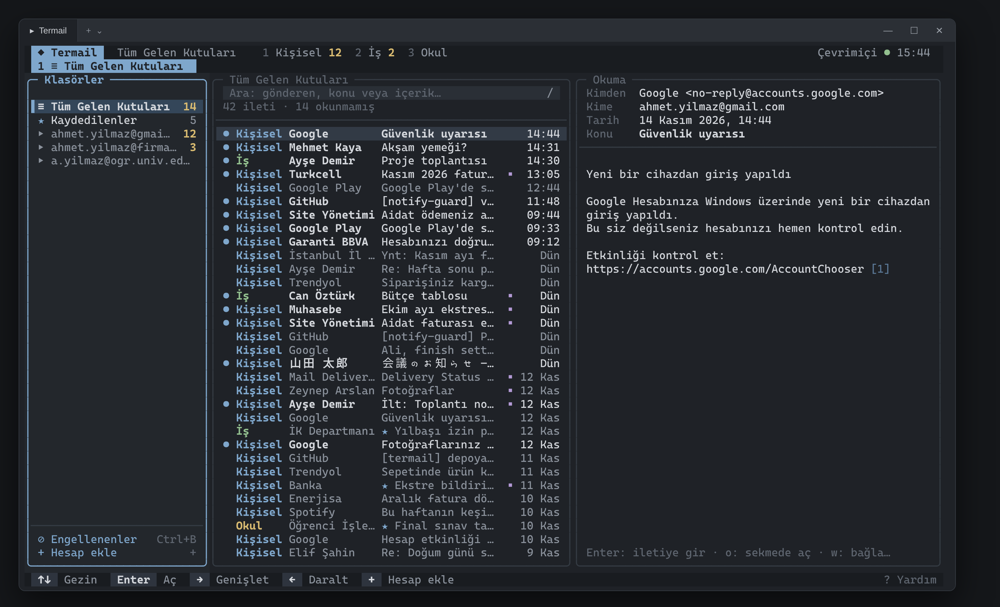
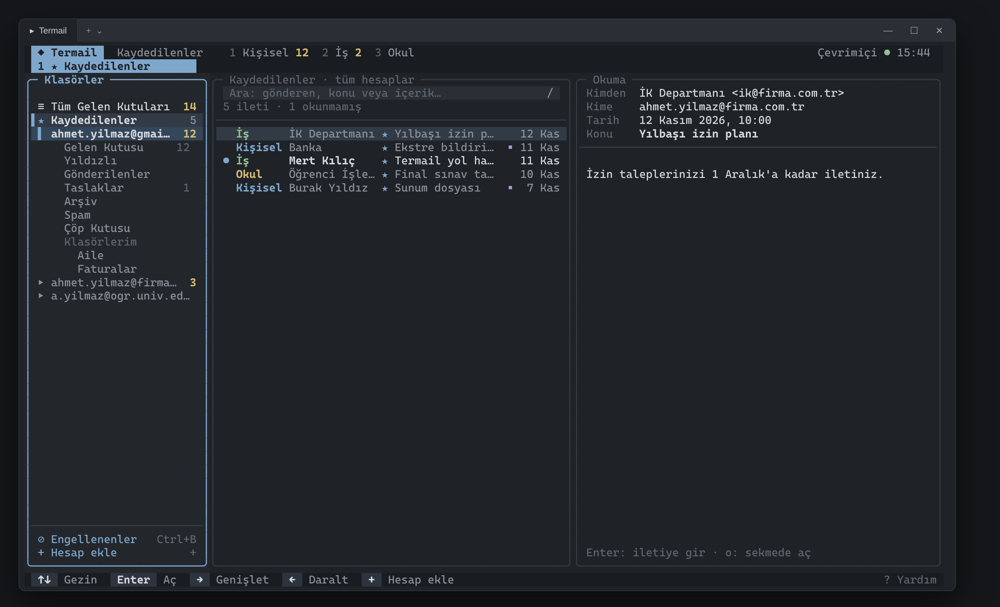

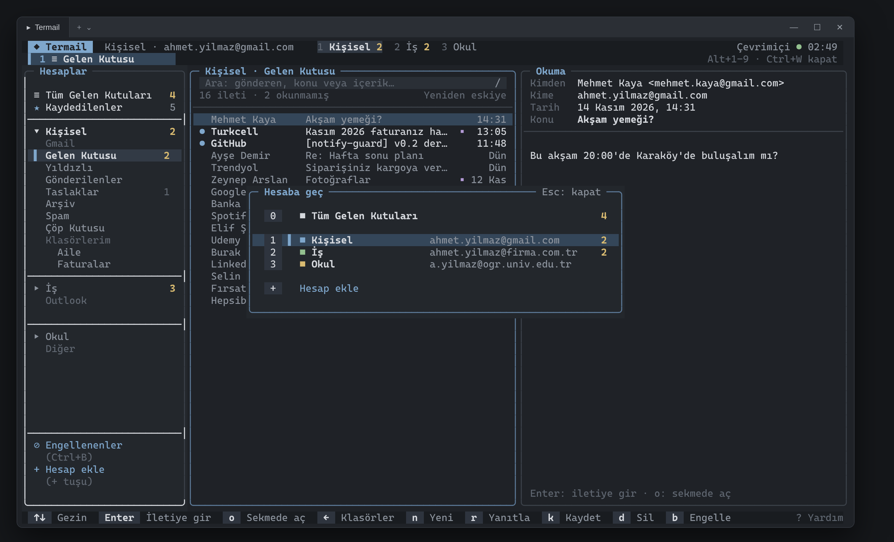
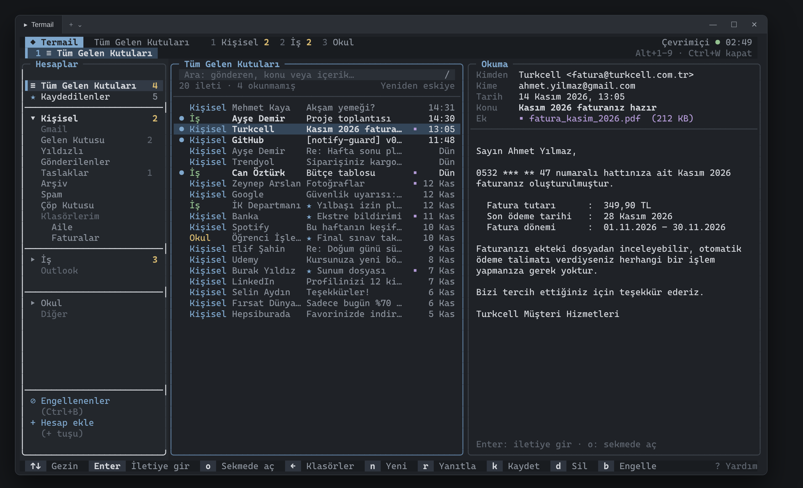

## Kaydedilenler

**k** ile bir iletiyi sonraya kaydedersin; listede ★ işareti çıkar. Klasör panelindeki **Kaydedilenler**, bütün hesaplardaki kayıtlı iletileri bir arada gösterir. Gmail ve Outlook'ta "yıldızlı" işaretiyle aynıdır, yani telefonda da görünür.

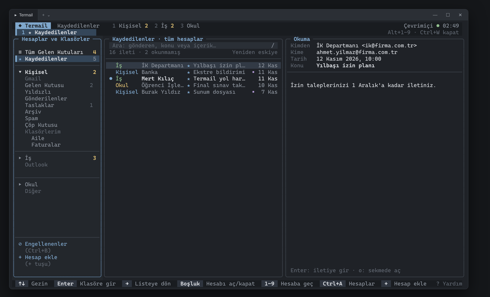

## Engelleme

- **b**: gönderen kişiyi engeller. **B**: o alan adından gelen her şeyi engeller.
- Engellenen kişilerden gelen iletiler İstenmeyen klasörüne taşınır.
- **Ctrl+B** (B harfi): engellenenler listesi; buradan engel kaldırılabilir.

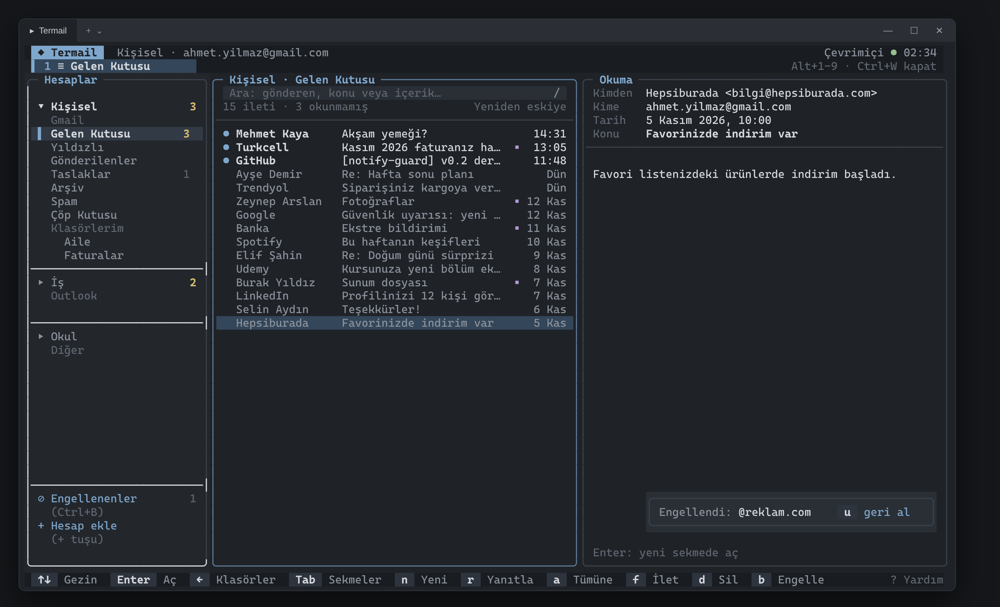

## Ekler

Okuma panelinin üstünde iki sekme vardır: **Mail** ve **Ekler ve Bağlantılar (3 · 5)** (ek sayısı · bağlantı sayısı). İletinin içindeyken **e** iki sekme arasında geçer; **Shift+E** listede iletiyi doğrudan ikinci sekmede açar; sekmelere tıklamak da olur. İkinci sekmede önce ekler (tür etiketi PDF / Tablo / Resim / Metin / Arşiv / Dosya, ad, boyut), sonra bağlantılar sıralanır. Her bağlantı, iletideki yazısıyla (yazı yoksa iletide hemen önündeki cümleyle) ve altında **gerçekte gittiği siteyle** görünür; yazı başka bir adresi gösteriyorsa satır kırmızıdır ve **"Dikkat: farklı adrese gidiyor"** yazar. **↑ ↓** ile gezin, **1–9** ile o numaralı bağlantıya git (bağlantı yoksa o sıradaki eke; bu sekmede rakamlar hesap değiştirmez). **Enter**: bağlantıyı tarayıcıda açar (yalnızca http, https, mailto) ya da eki geçici bir klasöre kaydedip Windows'taki varsayılan programıyla açar. `.exe`, `.bat`, `.js`, `.msi` gibi program dosyaları açılmadan önce sorulur; yalnızca **e** onaylar. **s** eki İndirilenler'e kaydeder, **y** bağlantının adresini kopyalar, **Esc** Mail sekmesine döner. Seçili ekin altında hızlı önizleme çıkar: metin, CSV (hizalı tablo) ve JSON doğrudan; PNG / JPEG / GIF resimler küçük bir resim olarak; PDF için "PDF önizlemesi yok, Enter ile aç" yazar. Ek ve bağlantı yoksa "Bu iletide ek ya da bağlantı yok" yazar. (Listede **e** arşivlemedir; iletinin içinde arşivleme tuşu yoktur, bu yüzden karışmaz.) Aynı adda dosya varsa üzerine yazılmaz, yeni bir ad verilir. **w** bağlantı listesi penceresi de hâlâ çalışır.

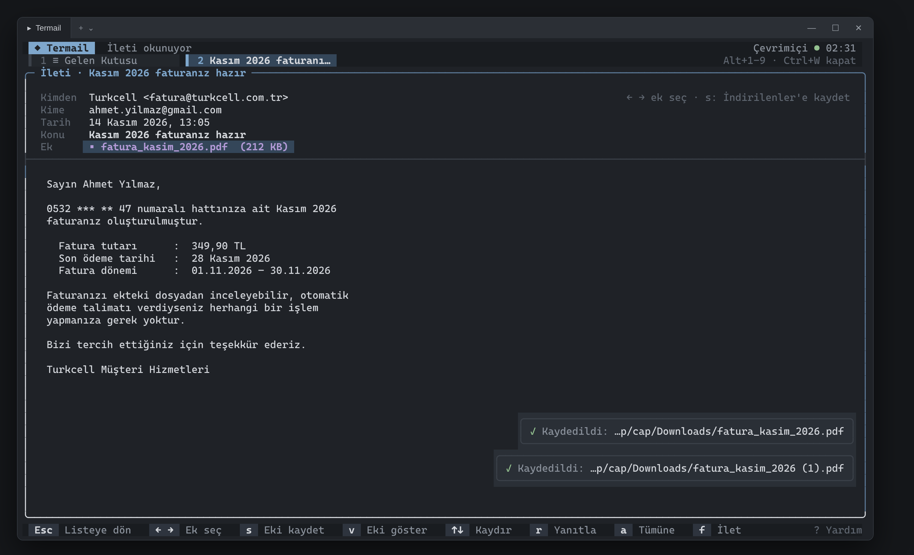

## Açılış ve kapanış

- **Açılış beklemez.** Pencere hemen çizilir; hesaplar ayarlardan, gelen kutusu da son açılıştan kalan yerel listeden gelir. Sağ üstte kısa bir süre "Bağlanıyor…" görünür; bu sırada kayıtlı giriş okunur, sunucuya bağlanılır, önce gelen kutusunun görünen ilk sayfası, sonra listenin geri kalanı ve klasörler yüklenir. Her hesap kendi başına bağlanır; erişilemeyen bir sunucu diğerlerini ve ekranı bekletmez.
- **Kapanış beklemez.** **q**, **Ctrl+C** (metin seçili değilken, bir yazı alanının dışında) ya da pencerenin **X** düğmesi programı hemen kapatır; sunucuya "hoşça kal" demek için beklenmez, bağlantılar doğrudan kesilir.
- **Gönderilmekte olan ileti varsa** **q** önce onun bitmesini bekler ("Gönderiliyor… bitince kapanacak"), en çok 15 saniye. Beklemek istemezsen bir kez daha **q** bas.
- **Hiçbir şey kaybolmaz:**
  - Sunucunun henüz onaylamadığı işlemler (silme, taşıma, okundu, kaydet) bir sonraki açılışta kendiliğinden tamamlanır.
  - Pencere kapatılırken açık duran ve gönderilmemiş iletiler kaydedilir; bir sonraki açılışta kendi sekmelerinde geri gelir. Gönderilirken kapatılan bir ileti de geri gelir; gidip gitmediğini Gönderilenler'den kontrol et.

## Dosyalar nerede?

- Ayarlar: `%APPDATA%\Termail\config.json` (yalnızca hesap adresleri ve tercihler; **şifre yok**).
- Şifreler ve oturum bilgileri: Windows Kimlik Bilgileri Yöneticisi (Credential Manager).
- Kaydedilen ekler: İndirilenler klasörün.
- Hızlı açılış için yerel liste: `%LOCALAPPDATA%\Termail\cache\`. Her hesabın gelen kutusundan son 300 iletinin yalnızca başlıkları (gönderen, konu, tarih, okundu/kayıtlı işareti) tutulur; **ileti içeriği, şifre, kod yoktur**. Silinirse ya da bozulursa bir şey olmaz, liste sunucudan yeniden gelir.
- Görünüm tercihleri (son aramalar, gruplama, açık hesaplar): aynı klasörde `arayuz.json`. Yalnızca aradığın sözcükler tutulur.
- Henüz tamamlanmamış işlemler: aynı klasörde `bekleyen-islemler.json` (tamamlanınca silinir).
- Kapanırken kaydedilen yarım iletiler: `%LOCALAPPDATA%\Termail\taslaklar\` (yeniden açılınca silinir).

## Geliştiriciler için

### Derleme

Go 1.27 veya üstü gerekir.

```
cd src
GOOS=windows GOARCH=amd64 CGO_ENABLED=0 go build -ldflags "-s -w -X termail/internal/auth.DefaultMSClientID=456b7094-6cbb-4a4b-8b76-6a56fb79768e" -o ../termail.exe ./cmd/termail
go vet ./...
go test ./...
```

### Outlook girişini açmak (Microsoft uygulama kimliği)

Uygulama kimliği kodda tek bir yerde durur: `src/internal/auth/oauth.go` içindeki `DefaultMSClientID` (şu an `456b7094-6cbb-4a4b-8b76-6a56fb79768e`; gizli bir bilgi değildir). Giriş: `https://login.microsoftonline.com/common`, önce tarayıcı + PKCE (`http://localhost:<rastgele port>`), olmazsa cihaz kodu. Kapsamlar: `IMAP.AccessAsUser.All`, `SMTP.Send`, `offline_access`, `openid email profile`. Sunucular: `outlook.office365.com:993` ve `smtp.office365.com:587` (STARTTLS), XOAUTH2. Yenileme anahtarı yalnızca Windows Kimlik Bilgileri Yöneticisi'nde tutulur.

1. Azure Portal → "App registrations" → yeni kayıt. Hesap türü: "Personal Microsoft accounts and organizational accounts".
2. Platform olarak "Mobile and desktop applications" ekle, yönlendirme adresi `http://localhost`.
3. "Allow public client flows" seçeneğini aç (istemci gizli anahtarı gerekmez).
4. API izinleri (isteğe bağlı; giriş sırasında kullanıcıdan zaten istenir): Microsoft Graph → `offline_access`, `openid`, `email`, `profile`; Office 365 Exchange Online → `IMAP.AccessAsUser.All`, `SMTP.Send` (Delegated).
5. Kimliği koda yaz ya da derlerken göm:

```
go build -ldflags "-s -w -X termail/internal/auth.DefaultMSClientID=<uygulama-kimliği>" -o ../termail.exe ./cmd/termail
```

Denemek için yeniden derlemeden: `TERMAIL_MS_CLIENT_ID` ortam değişkeni veya `config.json` içindeki `microsoft_client_id`.

### Diğer

- Mimari notları: `ARCHITECTURE.md`.
- Açılış/kapanış süreleri: `termail --zaman` (ya da `TERMAIL_TIMING=1`) süreleri `%APPDATA%\Termail\termail.log` dosyasına `zaman …` satırları olarak yazar (ilk kare, giriş bilgisi, IDLE, klasörler, gelen kutusu ilk sayfa, çıkış). Şifre ya da anahtar asla yazılmaz.
- Ekran çizimi: her kare pencere boyutuna tam oturtulur (satır sayısı = pencere yüksekliği, her satır en fazla genişlik − 1 hücre; son sütun bilerek boş bırakılır). Pencere boyutu Windows'ta doğrudan konsoldan okunur ve saniyede bir yeniden kontrol edilir. Genişliği terminalden terminale değişen karakterler (emoji, görünmez karakterler, kontrol karakterleri) çizimden önce ayıklanır.
- Gerçekçi örnek iletiler: `src/internal/samplemail` (imzalı Gmail başlıkları, yalnız HTML, ISO-8859-9 / Windows-1254, iç içe ekler, emoji konular, teslim raporu). Testler, `--demo` ve `cmd/localmail` bunları kullanır.
- Ekran görüntüleri `screenshots/` klasöründe; `tools/` içindeki betiklerle (`--demo` modunda) üretildi.

## Bilinen sınırlar

- Emoji ve benzeri simgeler konu/gönderen satırlarında gösterilmez (ekranın kaymaması için).
- Görüntü testleri Linux'ta bir terminal kaydıyla yapıldı; gerçek Windows Terminal / klasik konsol bu ortamda denenemedi.

- Bazı iş/okul hesaplarında yönetici, posta programlarıyla girişi ya da üçüncü taraf uygulamaları kapatmış olabilir; o zaman giriş yönetici onayı ister.
- Google ile tarayıcıdan giriş yok; Gmail için uygulama şifresi kullanılır.
- HTML iletiler sade metin olarak gösterilir.
- Fare desteği Linux'ta bir terminal kaydıyla denendi; Windows'ta fare olaylarını Bubble Tea kütüphanesi doğrudan konsoldan okur ve program kapanırken konsolu eski haline döndürür, ama gerçek bir Windows makinesinde denenemedi.
- Kopyalama/yapıştırma Linux'ta bir terminal kaydıyla denendi (fareyle seçip kopyalama, yapıştırma, Ctrl+C ile kopyalama). Windows panosuna yazma ve okuma gerçek bir Windows makinesinde denenemedi. Klasik konsol penceresinde (Windows Terminal değil) yapıştırılan yazı tek tek tuş olarak gelebilir; o zaman tek satırlık bir alana yapıştırılan satır sonları Enter gibi davranıp sonraki alana geçebilir. Uzun yazıları ileti metnine Ctrl+V ile yapıştırmak en güvenlisidir.
- Konu (sohbet) görünümü, imzalar ve kurallar henüz yok.
